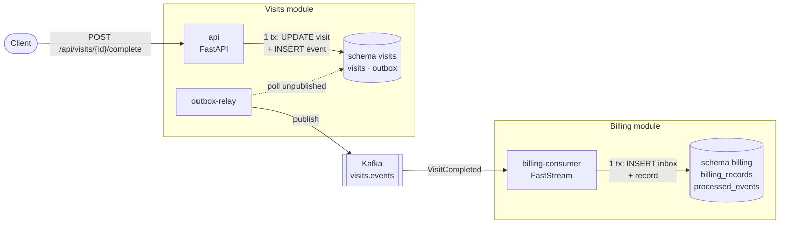
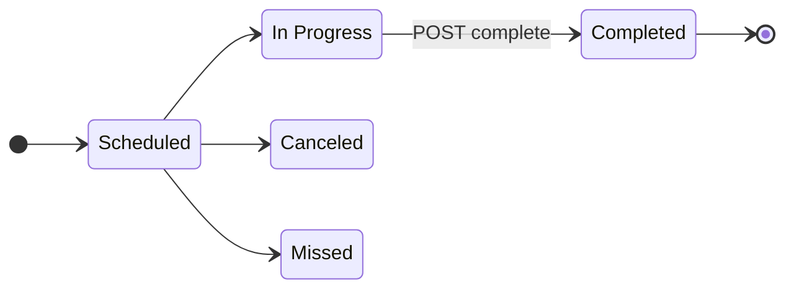
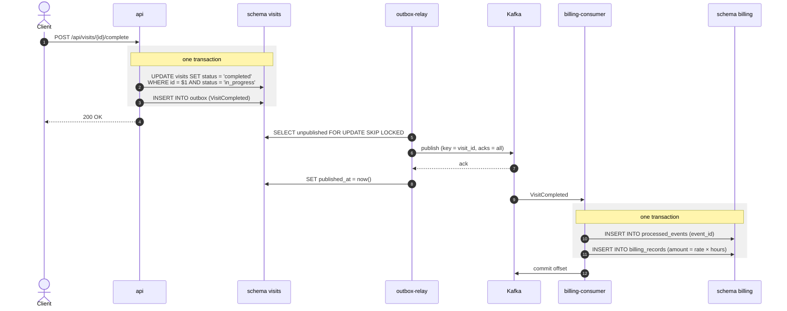
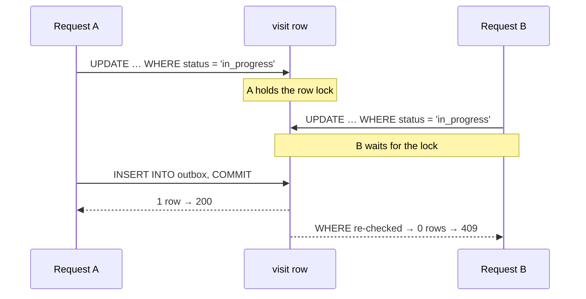
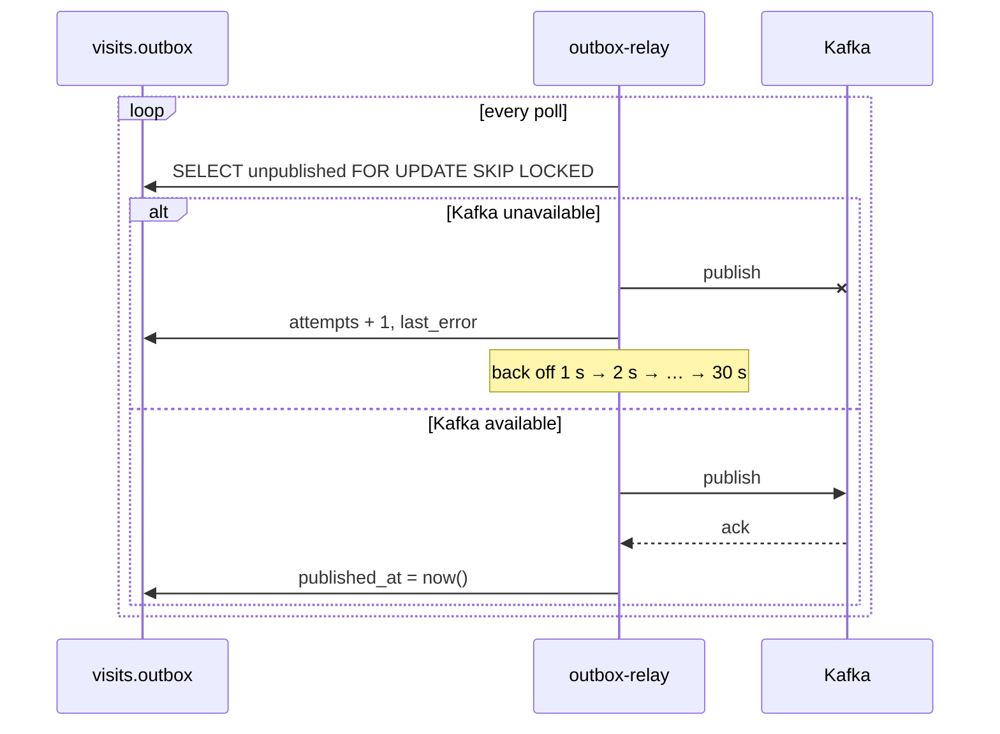
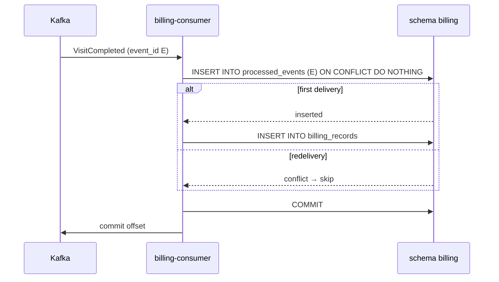
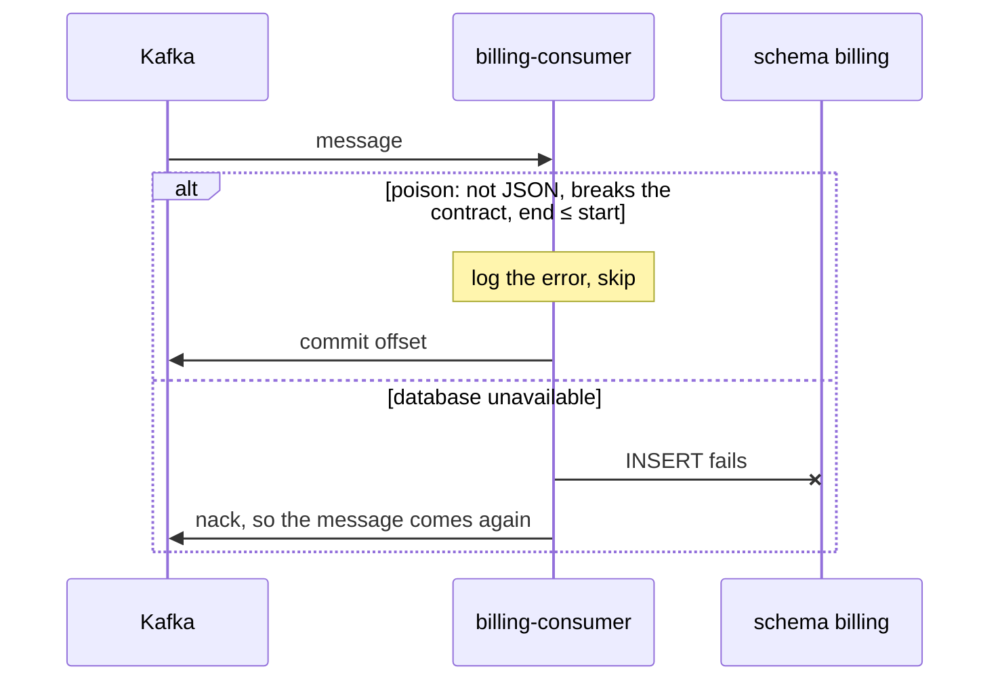
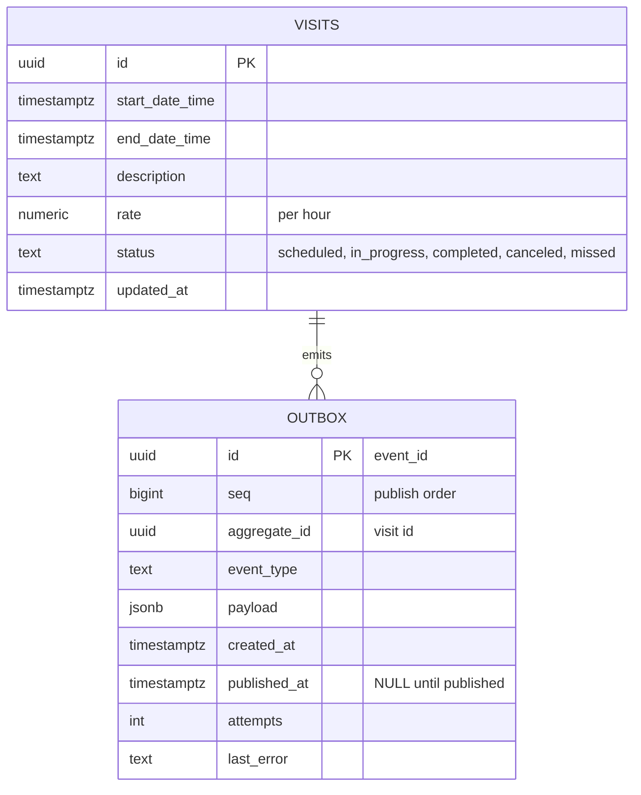
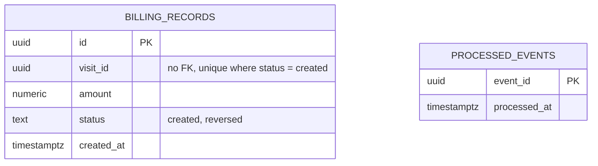

# Architecture

A modular monolith with two modules, **Visits** and **Billing**. Completing a visit always produces
exactly one billing record, even when Kafka is down, an event arrives twice, or two requests race.

## Overview



One PostgreSQL database with one schema per module. Neither module touches the other's schema; the
`VisitCompleted` event is the only link between them.

## Visit lifecycle



Only **In Progress → Completed** is implemented. The other arrows are there for context. Completing a
visit in any other status returns `409`.

## Completing a visit



## When things go wrong

### Two requests at once



After A commits, Postgres re-checks B's `WHERE` against the committed row, so only one request writes
a `VisitCompleted` event.

### Kafka is down



The event waits in the outbox, in the same database as the visit. When Kafka comes back, the relay
publishes it; nothing is lost and no one has to step in.

### An event arrives twice



Kafka may deliver an event more than once, but the inbox lets it take effect only once. A partial
unique index on `billing_records` is the last line of defence.

### A message can't be processed



A message that can never succeed is logged and skipped, so it can't block the partition. Visits never produces one,
because the same bounds apply on both sides. A dead-letter topic is the next step.

## Data model

**Schema `visits`**



**Schema `billing`**



`billing_records.visit_id` refers to a visit by its ID only. There is no foreign key between the modules.

## Event contract

Topic `visits.events`, key `visit_id`, headers `event_id` and `event_type`.

```json
{
  "event_id": "4f0c9a52-…",
  "event_type": "visits.visit_completed.v1",
  "occurred_at": "2026-11-11T10:00:00Z",
  "visit_id": "7e1b3d08-…",
  "start_date_time": "2026-11-11T08:00:00Z",
  "end_date_time": "2026-11-11T09:30:00Z",
  "rate": "40.00"
}
```

Billing computes the amount: 1.5 h × 40.00 = **60.00**. The `rate` travels as a string, so the
Decimal stays exact.

## Guarantees

| The task requires | Mechanism |
|---|---|
| A completed visit always gets a billing record, even if the broker is down | Transactional outbox; the relay retries with backoff; the consumer commits its offset only after its database commit |
| No second billing record when an event is delivered twice | Inbox (`processed_events`) written in the same transaction; partial unique index |
| No second billing record when two requests race | Conditional `UPDATE … WHERE status = 'in_progress'`, so there is one event per visit |
| Modules are separate and talk only through events | One schema per module; no foreign key between them; an import-linter contract |

## Key decisions

| Decision | Why |
|---|---|
| The API never connects to Kafka | Visits can still be completed while Kafka is down |
| `AckPolicy.NACK_ON_ERROR` | FastStream's default, `ACK_FIRST`, commits the offset before processing (at-most-once) |
| `auto_offset_reset = "earliest"` | Otherwise a new consumer group skips events published before it joined |
| No foreign key between modules | An FK is a hidden read, and a lock, on the other module's table |
| A transition table instead of the GoF State pattern | There is one transition, and the atomic `UPDATE` is the real guard |
| Duration in integer microseconds, converted to `Decimal` | Keeps floating-point rounding out of money |
