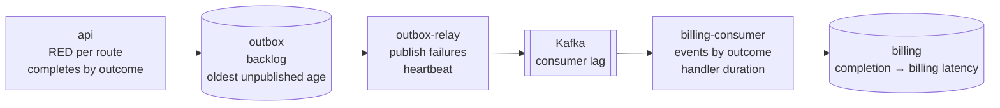
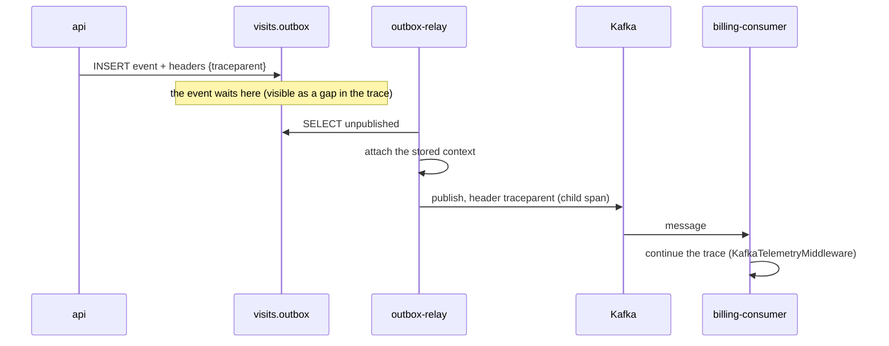
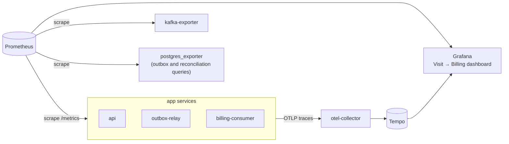

# Proposal: observability and monitoring

**Status:** proposal, not implemented.

The promise that every completed visit gets exactly one billing record spans four processes and two hops.
Monitoring must answer one question at a glance: **is anything stuck between "completed" and "billed", and where?**

## What to watch, hop by hop



## Metrics

| Metric | Type, labels | Source | Why |
|---|---|---|---|
| `http_requests_total`, `http_request_duration_seconds` | counter and histogram; route, status | `prometheus-fastapi-instrumentator` in api | rate, errors and duration for the API |
| `visit_transitions_total` | counter; target, outcome (`ok`, `not_found`, `conflict`) | visits service | a spike in `conflict` means clients are retrying or racing |
| `outbox_unpublished_events` | gauge | SQL: `count(*) WHERE published_at IS NULL` | how big the backlog is |
| `outbox_oldest_unpublished_age_seconds` | gauge | SQL: `now() - min(created_at) WHERE published_at IS NULL` | **the** signal for "stuck before Kafka" |
| `outbox_publish_failures_total` | counter; error type | relay, next to `record_failure` | Kafka trouble |
| `relay_heartbeat_timestamp_seconds` | gauge | relay, on every loop, even when idle | a dead or hung relay |
| `faststream_received_processed_messages_total`, `…_duration_seconds`, `…_exceptions_total` | built in | `KafkaPrometheusMiddleware` on the consumer broker | rate, errors and duration for the consumer |
| `billing_events_total` | counter; outcome (`billed`, `duplicate`, `poison`) | billing handler | `duplicate` proves the inbox works; `poison` must stay 0 |
| `billing_completion_to_billing_seconds` | histogram | handler: `now() - event.occurred_at` | end-to-end latency, the number users feel |
| `kafka_consumergroup_lag` | gauge; group, partition | `kafka-exporter` | a stuck or slow consumer |
| Postgres connections, locks, size | gauges | `postgres_exporter` | the shared dependency |

**The backlog gauges come from SQL, not from the relay.** A dead relay can't report its own backlog, so these run
as custom queries in `postgres_exporter` (or `sql_exporter`).

## Alerts

| Alert | Condition | Severity | Meaning |
|---|---|---|---|
| OutboxStuck | `outbox_oldest_unpublished_age_seconds > 300` for 5 min | page | Kafka is down or the relay is dead. Events wait safely, but billing is late |
| RelayDown | `up{job="outbox-relay"} == 0`, or the heartbeat is older than 2 min | page | no process is publishing |
| BillingLag | the `billing` group's lag grows for 10 min, or completion → billing p99 > 5 min | page | the consumer is stuck or too slow |
| ConsumerErrors | `rate(faststream_received_processed_messages_exceptions_total[5m]) > 0` for 10 min | page | the database is down and the consumer is in a nack loop |
| PoisonMessage | `increase(billing_events_total{outcome="poison"}[15m]) > 0` | ticket | an event was skipped and someone has to fix the data by hand (there is no dead-letter topic yet) |
| UnbilledVisits | `reconciliation_unbilled_visits > 0` | page | the invariant itself is broken (see below) |
| ApiErrors | 5xx ratio > 1 %, or p99 > 500 ms, for 5 min | page | the API is unhealthy |

## The business check: reconciliation

Every metric can be green while one visit still went unbilled: a skipped poison message, or a row someone edited by
hand. So a job checks the invariant itself every few minutes and exports the count as
`reconciliation_unbilled_visits`:

```sql
SELECT count(*)
FROM visits.visits v
LEFT JOIN billing.billing_records b ON b.visit_id = v.id AND b.status = 'created'
WHERE v.status = 'completed'
  AND v.updated_at < now() - interval '15 minutes'
  AND b.id IS NULL
```

This is the one query that joins across the two schemas. It runs outside both modules, under a read-only ops role,
because it audits the boundary and is not module logic. The module code still never reads the other module's tables.

## Logs

- **Format:** JSON to stdout, one object per line, with `ts`, `level`, `service`, `msg`, `trace_id`, `span_id`,
  `visit_id`, `event_id` and `outcome`.
- **One setup module:** a single `app/shared/logging.py` used by all three processes. Today only the relay calls
  `basicConfig`, so `faststream run` hides the consumer's INFO lines.
- **No personal data:** log ids, never payloads. `description` may hold personal data.
- **Levels:** a skipped duplicate is INFO, a failed publish is WARNING, and a poison message is ERROR.

## Traces: one trace from the request to the billing record

The outbox breaks the in-process trace context, because the relay publishes later from another process. The fix is to
**store the W3C `traceparent` in the outbox row**. The relay re-activates it before publishing, and the Kafka header
carries it to the consumer:



- **Migration:** `ALTER TABLE visits.outbox ADD COLUMN headers jsonb NOT NULL DEFAULT '{}'`. The relay merges these
  headers with `event_id` and `event_type`.
- **Instrumentation:**
  - api: `opentelemetry-instrumentation-fastapi` and `opentelemetry-instrumentation-asyncpg`;
  - relay and consumer: FastStream's `KafkaTelemetryMiddleware` (`faststream[otel]`) on each `KafkaBroker`. In the
    relay it injects the attached context into the headers by itself.
- **Export:** OTLP to an OpenTelemetry Collector, then to Tempo or Jaeger.
- **What it buys:** one trace shows the request, the time spent waiting in the outbox, the publish, the consume and
  the insert, so a slow hop is visible straight away.

## Health checks

| Process | Liveness | Readiness |
|---|---|---|
| api | `GET /health/live` | `GET /health/ready` runs `SELECT 1` on the pool |
| billing-consumer | `FastStream` → `AsgiFastStream` with `("/health", make_ping_asgi(broker, timeout=5.0))` | the same ping, which checks the broker connection |
| outbox-relay | heartbeat freshness, `/metrics` served by `prometheus_client.start_http_server` | none; it has no traffic to receive |

Compose gets `healthcheck:` entries, so `depends_on` can use `condition: service_healthy`.

## Local stack



`docker compose --profile observability up` starts this stack beside the app, with the dashboard and alert rules
provisioned from files in the repo. The dashboard follows the pipeline from top to bottom: completes per second by
outcome, then the outbox backlog and its oldest age, consumer lag, completion → billing latency (p50 and p99), and
last poison skips and unbilled visits.

## Keeping the module boundary

The import-linter contract says the API never imports `faststream` or `aiokafka`. So FastStream's middlewares are
wired in `app/billing/consumer.py` and `app/visits/relay.py`, never in a shared module the API also imports.
`app/shared/` holds only the library-neutral pieces: logging, the OTel provider and the Prometheus registry.

## Tests

- **Counters:** each outcome increments its counter. Read them from a fresh `CollectorRegistry` in the test.
- **Trace propagation:** an e2e test with an in-memory span exporter checks that the billing span has the same
  `trace_id` as the API span.
- **Alert rules:** `promtool test rules` against fixture series.

## Rollout

1. JSON logs carrying `visit_id` and `event_id`. This is the smallest change and helps right away.
2. `/metrics`, the health endpoints, and alerts on outbox age, consumer lag and poison skips.
3. The reconciliation gauge.
4. Tracing through the outbox, which needs the `headers` migration.
