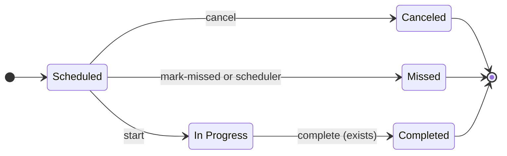
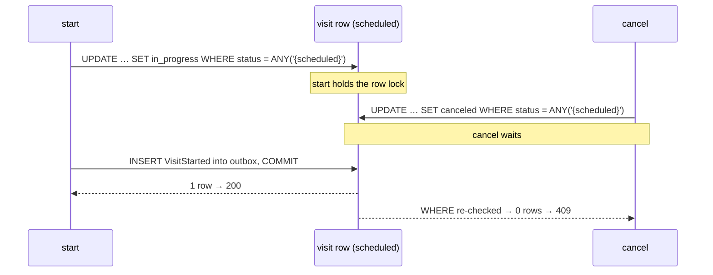
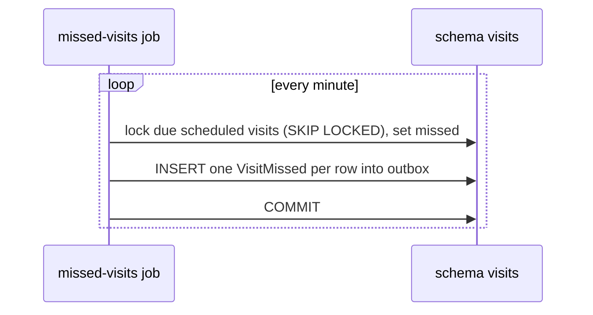
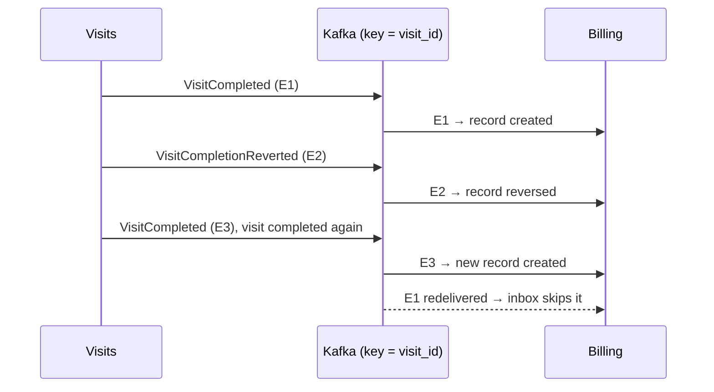

# Proposal: the other visit transitions

**Status:** proposal, not implemented.

Only **In Progress → Completed** exists today. This proposal adds the rest of the lifecycle and keeps the three
guarantees: one conditional `UPDATE`, one outbox event in the same transaction, and consumers that are idempotent.

## Target lifecycle



| Command | Endpoint | From | To | Event |
|---|---|---|---|---|
| start | `POST /api/visits/{id}/start` | scheduled | in_progress | `visits.visit_started.v1` |
| complete | `POST /api/visits/{id}/complete` (exists) | in_progress | completed | `visits.visit_completed.v1` |
| cancel | `POST /api/visits/{id}/cancel`, body `{"reason": "…"}` | scheduled | canceled | `visits.visit_canceled.v1` |
| mark missed | `POST /api/visits/{id}/mark-missed`, or the scheduler | scheduled | missed | `visits.visit_missed.v1` |

Every command answers like `/complete` does: `200` with the visit, `404` for an unknown id, and `409` from a wrong
status.

**Why commands and not `PATCH {"status": …}`:** each command states its intent and gets its own body (for example
the cancel reason), permissions, audit entry and `409` message. A writable `status` field would push the state machine
out to the clients.

## One table drives everything

`app/visits/status.py` already maps each source to its targets. The table grows, and a second map names each
target's event:

```python
TRANSITIONS = {
    VisitStatus.SCHEDULED: frozenset({VisitStatus.IN_PROGRESS, VisitStatus.CANCELED, VisitStatus.MISSED}),
    VisitStatus.IN_PROGRESS: frozenset({VisitStatus.COMPLETED}),
}

EVENTS = {
    VisitStatus.IN_PROGRESS: VisitStartedV1,
    VisitStatus.COMPLETED: VisitCompletedV1,
    VisitStatus.CANCELED: VisitCanceledV1,
    VisitStatus.MISSED: VisitMissedV1,
}
```

`mark_completed` becomes `set_status`, and `complete_visit` becomes `transition`. Each endpoint is then a one-line
call:

```python
async def transition(pool, visit_id, target, **details) -> Visit:
    async with pool.acquire() as conn, conn.transaction():
        row = await repository.set_status(conn, visit_id, target, sources_for(target))
        if row is None:
            ...  # 404 or 409, exactly as complete_visit does today
        event = EVENTS[target].from_row(row, **details)
        await outbox.insert_event(conn, event)
        return to_visit(row)
```

```sql
UPDATE visits.visits SET status = $2, updated_at = now()
WHERE id = $1 AND status = ANY($3::text[])
RETURNING *
```

**Still no GoF State classes:** each state has no behaviour of its own beyond "allowed or not" and "which event", and
the SQL guard is needed either way. Revisit this if states gain real behaviour.

## Conflicting commands race safely

The guard that stops two `complete` requests also settles any pair of commands that conflict:



## Events

- **Every transition writes an event.** The outbox makes this cheap, and later modules (notifications, payroll,
  analytics) can subscribe without changing Visits.
- **Topic and key:** the same topic `visits.events` with key `visit_id`, so one visit's events stay in order:
  started comes before completed.
- **Billing ignores the new types.** It already skips any `event_type` it doesn't handle (`app/billing/handler.py`)
  and commits the offset.
- **Each event is versioned (`.v1`)** and carries the state its consumers need, as `VisitCompleted` does today.

## Missed: a scheduler, not only a button

A visit nobody started is missed once a grace period has passed. A job runs every minute and moves due visits in
batches. Each moved row writes its event in the same transaction:



```sql
WITH due AS (
    SELECT id FROM visits.visits
    WHERE status = 'scheduled' AND start_date_time < now() - $1::interval
    ORDER BY start_date_time
    LIMIT $2
    FOR UPDATE SKIP LOCKED
)
UPDATE visits.visits v SET status = 'missed', updated_at = now()
FROM due
WHERE v.id = due.id AND v.status = 'scheduled'
RETURNING v.*
```

- **A late `start`** either wins the row lock, so the job skips the row, or it gets `409`.
- **Index:** a partial index `ON visits.visits (start_date_time) WHERE status = 'scheduled'` keeps the query cheap.
- **A deliberate change:** this is the first time-based rule. Today's assumption is "no time-based checks".

## Later: undoing a completion (touches Billing)

Completed stays a final state unless the product asks for corrections. If it does, the flow looks like this:



- **Billing** marks the active record `reversed` in the same transaction as its inbox row. The partial unique index
  (`WHERE status = 'created'`) then lets a new completion create a new record.
- **A redelivered old event** (`E1`) is stopped by the inbox, because its `event_id` is already there.
- **Ordering:** the key `visit_id` keeps E1 → E2 → E3 in order within one partition.
- **The README caveat:** today a second `VisitCompleted` hits the index and rolls back its inbox row. With reversals,
  Billing should check "already billed" explicitly instead of relying on the index.

## Tests

- **Every status against every target:** an allowed move returns `200` and writes one outbox event of the right type;
  any other move returns `409` and writes nothing.
- **A race test for each pair that conflicts:** start vs cancel, and start vs the missed job. They reuse
  `tests/pg_helpers.py::wait_for_lock_waiters`.
- **One contract test per new event.**

## Rollout

1. Add `set_status` and the generic `transition`, and run `complete` through them with no change in behaviour. The
   existing tests must stay green.
2. Add `start`, `cancel` and `mark-missed` with their events.
3. Add the missed-visits job.
4. Add reversal in Visits and Billing, only if the product asks for it.

## Open questions for the product

- Can a visit that is already in progress be canceled?
- How long is the grace period before a visit counts as missed?
- Can a completed visit be corrected? If so, does Billing void the record or issue a credit note?
